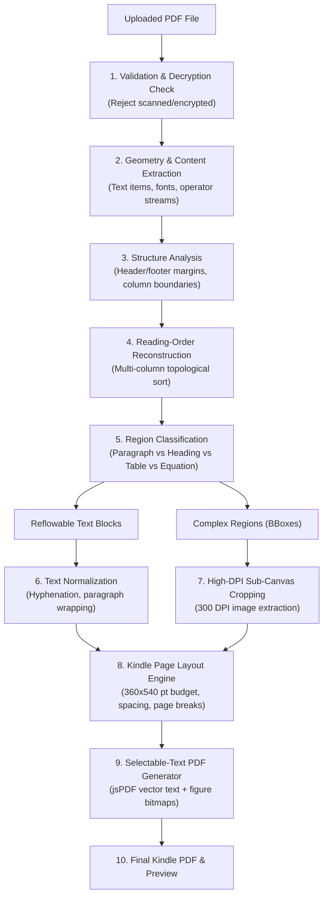

# KindleFlow — Project Status & Technical Architecture

## 1. Project Objective

**KindleFlow** is a browser-based, client-side academic PDF reflow tool specifically designed to optimize academic documents (particularly those exported from Notion, LaTeX, and standard academic journals) for 6-inch e-readers, primarily the **Amazon Kindle Basic** (e-ink display, 6″ diagonal, ~1072 × 1448 px at 300 PPI; 360 × 540 pt or 432 × 576 pt virtual print canvas).

### The Problem
Conventional PDF conversion tools (such as K2pdfopt or raw text extractors) frequently fail on structured academic documents:
- Text reflow algorithms mangle multi-column layouts, resulting in mixed reading order.
- Mathematical equations, chemical formulas, and tabular data get torn apart or overlap adjacent text.
- Full-page image downscaling renders academic text blurry, illegible, and non-selectable on small 6-inch displays.

### The Solution: Hybrid Structure-Aware Engine
KindleFlow implements a hybrid conversion engine:
1. **Reflowable Content**: Normal paragraphs, section headings, bulleted lists, definitions, and text callouts are extracted, reconstructed, and typeset as crisp, selectable text fitted to the Kindle's page geometry.
2. **Complex Content**: Mathematical formulas (display equations), tables, charts, figures, and diagrams are identified, isolated, and preserved as high-resolution, cropped image regions placed cleanly between reflowed paragraphs without overlapping or text clipping.
3. **100% Client-Side Privacy**: All processing runs locally in the user's web browser without cloud APIs, servers, accounts, or telemetry.

---

## 2. Technology Stack

- **Framework**: [Next.js](https://nextjs.org/) 16.4.3 (App Router, Turbopack)
- **Runtime / UI**: React 19.2.4, TypeScript 5.7.3
- **Styling**: Tailwind CSS v4.3.3 (`@tailwindcss/postcss`), `tw-animate-css`, `@base-ui/react`, Lucide React
- **PDF Engine**: `pdfjs-dist` (v6.5.438) for parsing, font extraction, operator streams, and canvas rendering
- **PDF Generation**: `jspdf` (v4.2.1) for vector text typesetting, high-res bitmap embedding, and page generation
- **Package Manager**: pnpm (v11 / v12)

---

## 3. Codebase Audit & Current Implementation Status

### 3.1 What Currently Works
- **File Ingestion**: Drag-and-drop and native file input accepting `application/pdf`.
- **Dynamic PDF.js Loading**: Dynamically imports `pdfjs-dist/legacy/build/pdf.mjs` on demand.
- **Canvas Rendering Loop**: Renders pages sequentially to HTML5 canvas elements at `scale = 1.5`.
- **jsPDF Export**: Packages canvas captures into a jsPDF document and initiates browser download (`<filename>-kindle.pdf`).
- **Basic UI States**: Drag states, loading spinner ("Converting locally..."), and file removal.

### 3.2 What Was Decorative, Mock, or Misleading
- **Preview Area (`PreviewPage`)**:
  - The preview pane displays hardcoded skeleton bars (`<div className="h-1 rounded-full bg-[#d9dde2]" ... />`).
  - It does not render either the source PDF or the converted output.
  - The "Original" vs. "Converted" tab buttons, zoom controls, and "Page 1 of 12" counter are static mock elements without event listeners or state.
- **Conversion Settings (Advanced Options)**:
  - Settings for Margins (`Standard`, `Narrow`, `Wide`), Text scaling (`90%`, `100%`, `110%`, `120%`), Resolution (`200 DPI`, `300 DPI`, `400 DPI`), Orientation (`Portrait`, `Landscape`), and Toggles (`Preserve equations`, `Preserve tables`) are saved in component state but **100% ignored** by `convert()`.
- **Secondary Actions**:
  - "Open recent" button has no backing storage or action.
  - "Kindle Basic · 6″" device selector is a static non-interactive dropdown.
  - "Export converted PDF" button appears after conversion but has no `onClick` handler (the download was already triggered automatically by `output.save()`).
- **Build Configuration**:
  - `next.config.mjs` contained `typescript: { ignoreBuildErrors: true }`. This suppressed build validation. (Audited, tested, and resolved to `ignoreBuildErrors: false`; code builds cleanly).

### 3.3 What Needs Complete Replacement
- **The Conversion Engine (`convert()` in `components/converter-workspace.tsx`)**:
  - Current implementation is simply a **page screenshot generator**. It scales down entire A4/Letter pages into 360 × 540 pt images. Text is unreflowed, unselectable, and illegible on a 6-inch e-reader.
  - Must be replaced with the modular, 10-stage hybrid reflow pipeline described below.
- **PDF.js Worker Source**:
  - Currently loads worker from `https://unpkg.com/pdfjs-dist@${pdfjs.version}/build/pdf.worker.min.mjs`.
  - Must be bundled locally or served from the local Next.js `/public` directory to guarantee 100% offline, local-first operation.

---

## 4. Proposed Conversion Architecture

The reflow engine is structured as a decoupled, testable pipeline under `lib/converter/`:

```
lib/converter/
├── types.ts                    # Core data structures (BBoxes, Blocks, LayoutItems, Config)
├── validator.ts                # PDF validation, encryption check, scanned page detection
├── worker-loader.ts            # Local PDF.js worker initializer (offline-safe)
├── extractor.ts                # Text items, font matrices, operator streams (paths/images)
├── structure-analyzer.ts       # Margin detection, header/footer suppression, column detection
├── reading-order.ts            # XY-Cut sorting, column traversal, span-to-line assembly
├── classifier.ts               # Semantic classification (reflowable text vs equations/tables/figures)
├── text-reflower.ts            # Hyphen unwrapping, paragraph formation, heading scale
├── region-preserver.ts         # High-DPI sub-canvas cropping for complex elements
├── layout-engine.ts            # Kindle virtual page budget, line breaks, orphan control, pagination
├── pdf-generator.ts            # jsPDF generation with selectable text and embedded figures
└── index.ts                    # Main orchestrator pipeline
```

### Pipeline Flow



### Detailed Pipeline Responsibilities:

1. **Validation (`validator.ts`)**:
   - Inspects PDF binary header (`%PDF-`).
   - Verifies whether file is encrypted or password-protected.
   - Detects scanned PDFs: if page text item count is 0 and an image spans the entire page, raises an explicit `ScannedDocumentError` rather than generating empty pages.

2. **Extraction Engine (`extractor.ts`)**:
   - Queries `page.getTextContent({ includeMarkedContent: true })`.
   - Extracts `str`, `transform` matrix $[a, b, c, d, e, f]$, `fontName`, `width`, `height`, `dir`.
   - Computes exact coordinates: $x = e$, $y = f$, $\text{fontSize} = \sqrt{a^2 + b^2}$.
   - Queries `page.getOperatorList()` to detect vector stroke/fill commands (lines, table borders, dividers) and bitmap commands (`paintImageXObject`).

3. **Structure Analysis (`structure-analyzer.ts`)**:
   - Calculates page bounding boxes and page margin boundaries.
   - Filters out repetitive headers and footers (page numbers, running headers).
   - Detects column structures: single-column vs. two-column layouts via horizontal whitespace gaps and projection profiles.

4. **Reading-Order Reconstruction (`reading-order.ts`)**:
   - Applies an XY-Cut / recursive spatial decomposition to group text elements into logical column sequences.
   - Groups adjacent text fragments on the same baseline into coherent lines and words using font character widths.

5. **Region Classification (`classifier.ts`)**:
   - **Reflowable**: Body paragraphs, headings (H1/H2/H3 detected by font size relative to body text), bullet lists (`•`, `-`, numbers), callouts.
   - **Complex Regions**:
     - *Equations*: Character sequences with high math symbol density, sub/superscript baseline shifts, or fraction line paths.
     - *Tables*: Rectangles with internal grid lines or multiple aligned columns without paragraph flow.
     - *Figures & Diagrams*: Image operators and vector graphics clusters.

6. **Reflowable Content Reconstruction (`text-reflower.ts`)**:
   - De-hyphenates words broken across line breaks.
   - Collapses intra-paragraph line breaks into continuous fluid text while maintaining sentence boundaries.

7. **Complex Region Preservation (`region-preserver.ts`)**:
   - Instead of downsampling the whole page, crops the specific bounding box from a high-resolution source canvas (rendered at scale 2.5× to 3.0×, equivalent to 200–300 DPI).
   - Ensures images remain razor-sharp on e-ink displays.

8. **Kindle Page Layout Engine (`layout-engine.ts`)**:
   - Computes layout budget on target dimensions (Kindle Basic: 360 × 540 pt, margins 20–24 pt, usable width 312–320 pt).
   - Base font size: 10.5–11.5 pt, line height 1.45× (~15–16 pt).
   - Dynamically tracks remaining page height, applies widow/orphan rules, and inserts page breaks when a complex figure or heading cannot fit.

9. **PDF Generator (`pdf-generator.ts`)**:
   - Constructs a new document via `jsPDF`.
   - Writes selectable vector text (`doc.text(...)`).
   - Inserts cropped images (`doc.addImage(...)`) for preserved formulas and figures.

---

## 5. Dependency Assessment

| Dependency | Purpose | Assessment |
|---|---|---|
| `pdfjs-dist` (6.5.438) | PDF parsing, text extraction, operator analysis, canvas rendering | **Sufficient & Required**. Provides complete browser-native access to text items, geometric matrices, and vector operator streams. |
| `jspdf` (4.2.1) | Kindle output PDF generation | **Sufficient & Required**. Capable of writing selectable text with word wrapping, font styling, exact page sizes, and inserting high-res raster images. |
| Additional Libraries | Extra PDF/WASM parsers | **Not needed for initial MVP**. Introducing external WASM engines (e.g., pdf-lib, MuPDF WASM) adds massive bundle overhead without improving basic academic paper extraction. |

---

## 6. Known Technical Limitations & Constraints

1. **No Scanned PDF OCR**: PDFs without embedded text streams (pure image scans) cannot be reflowed in the initial MVP. They will be detected and flagged with a descriptive error.
2. **Inline Math Formulas**: Simple inline or plain single-line formulas without spatial complexity can be kept as selectable centered/inline text; multi-line, sub/superscript, symbol-dense, or vector-ruled equations are preserved as region boxes for high-DPI cropping.
3. **Notion Specifics**: Notion academic exports often include colored callout blocks, code blocks, and toggle lists. Callouts and code blocks are reflowed with indentation/whitespace hints, while callouts with embedded graphics are preserved as regions.
4. **Offline Worker**: `pdf.worker.min.mjs` must be hosted locally to avoid third-party CDN latency and offline failure.
5. **Fallback Text Measurement**: `text-reflower.ts` currently uses a deterministic character-class width estimator by default via the `TextMeasurer` interface; exact font metrics from `jsPDF` will be injected during PDF generation in Prompt 5+.
6. **No Cropping, Rotation, or PDF Export Yet**: `layout-engine.ts` outputs pure layout instructions (`LayoutDocument`) with source geometry references (`sourcePageNumber`, `sourceBox`). Actual high-DPI sub-canvas cropping, optional oversized table rotation, and `jsPDF` output generation belong to the PDF generation stage.

---

## 7. Eight-Prompt Development Roadmap

- [x] **Prompt 1: Codebase Audit, Technical Assessment & Conversion Architecture**
  - Complete codebase inspection, audit of working vs. decorative features, pipeline architecture design, dependency assessment, build baseline establishment, and `PROJECT_STATUS.md`.
- [x] **Prompt 2: Offline PDF.js Worker, Input Validation & Geometry Extraction**
  - Hosted exact matching `pdf.worker.min.mjs` (v6.5.438) locally in `public/`. Implemented `lib/converter/worker-loader.ts` for offline SSR-safe worker initialization.
  - Implemented `lib/converter/validator.ts` covering file-level validation (magic bytes, size limits, password encryption, corruption) and page-level density analysis.
  - Implemented `lib/converter/extractor.ts` normalizing text items, bounding boxes (top-left origin), font matrix scales, and operator list evidence (vector paths, lines, raster images).
  - Implemented `lib/converter/index.ts` pipeline coordinator with memory buffer safety (`bytes.slice()`) and progress callbacks.
  - Connected validation alerts, progress feedback, and extraction diagnostics to `components/converter-workspace.tsx`.
  - Added test suite `scripts/test-extraction.mjs` with 9 verified test scenarios (all 9 passed).
- [x] **Prompt 3: Document Structure Analysis & Column/Reading-Order Reconstruction**
  - Extended `lib/converter/types.ts` with `ConfidenceLevel`, `TextLine`, `TextBlock`, `DocumentBlockType`, `DocumentBlock`, `PageColumnLayout`, `AnalyzedPage`, and `AnalyzedDocument`.
  - Implemented `lib/converter/line-reconstructor.ts` for baseline grouping, word spacing preservation, column boundary separation, and soft-hyphenation joining utilities.
  - Implemented `lib/converter/structure-analyzer.ts` for body margin estimation, horizontal X-projection column detection (1, 2, or 3 columns with outer-margin exclusion), and cross-page running header/footer & page number detection.
  - Implemented `lib/converter/reading-order.ts` for XY-Cut spatial sorting across full-width elements and multi-column content.
  - Implemented `lib/converter/paragraph-reconstructor.ts` for vertical-gap and font-calibrated paragraph, heading, subheading, and list-item assembly with soft-hyphen resolution (prioritizing headings over numbered-list prefixes for numbered sections).
  - Implemented `lib/converter/classifier.ts` for heuristic classification with `ConfidenceLevel` and `preserveAsImage` flags across headings, lists, paragraphs, equations, bordered/borderless tables, figures, captions, callouts, code blocks, headers, and footers.
  - Updated `lib/converter/index.ts` with `analyzeDocument()` coordinating the non-destructive analysis pipeline.
  - Added `scripts/test-structure.mjs` (`pnpm test:structure`) covering 16 verified scenarios including an end-to-end `jsPDF -> extractDocument -> analyzeDocument` integration test (all 16 passed).
- [x] **Prompt 4: Hybrid Reflow & Kindle Page Layout Engine**
  - Extended `lib/converter/types.ts` with the layout data model: `FontStyleSpec`, `TextMeasurer`, `LayoutSettings`, `LayoutPage`, `LayoutElement`, `LayoutTextElement`, `LayoutPreservedRegion`, `LayoutDocument`, `LayoutWarning`, and `LayoutValidationReport`.
  - Implemented `lib/converter/text-reflower.ts` providing an injectable `TextMeasurer` abstraction, deterministic fallback measurer (`createFallbackTextMeasurer()`), word/hyphen/oversized-token wrapping, heading scaling, hanging list indentation, callout styling hints, and whitespace-preserving code-block wrapping.
  - Implemented `lib/converter/region-preserver.ts` enforcing hybrid reflow/preservation rules (reflow paragraphs/headings/lists/text-callouts/simple single-line equations; preserve spatial equations, tables, figures, and low-confidence graphics as aspect-ratio-safe regions), figure/table + caption pairing (`groupId`), dedicated pages (`minScaleRatio`), and legibility warnings without silent discarding.
  - Implemented `lib/converter/layout-engine.ts` generating a single-column Kindle `LayoutDocument` (configurable defaults: 432×576 pt, 11.5 pt body, 1.45 line spacing) with top-to-bottom placement, heading keep-with-next look-ahead, orphan/widow control, dedicated pages for oversized regions, and per-page error fallback.
  - Implemented `lib/converter/layout-validator.ts` detecting negative/invalid dimensions, page/margin overflows, pairwise overlaps (with `groupId` caption adjacency exemption), empty text elements, missing source refs, tiny preserved regions, and empty pages.
  - Updated `lib/converter/index.ts` exposing `layoutDocument()` (`extractDocument -> analyzeDocument -> layoutDocument`).
  - Added `scripts/test-layout.mjs` (`pnpm test:layout`) with 17 verified scenarios including validator error checks and an end-to-end `jsPDF -> extractDocument -> analyzeDocument -> layoutDocument -> validateLayout` test (all 17 passed).
- [x] **Prompt 5: Dual-Mode PDF Generation & Real-World Readiness Audit**
  - Implemented **Mode A (Notes Reflow)** in `lib/converter/pdf-generator.ts`: renders selectable vector text via `jsPDF`, preserves font weights, headings, lists, and line heights, injects live `jsPDF` font width measurement (`createJsPDFTextMeasurer()`), and crops preserved regions (equations, tables, diagrams) at 300 DPI from the original source PDF canvas without whole-page rasterization.
  - Implemented **Mode B (Slides / Image Enlargement)** in `lib/converter/slide-converter.ts`: renders original PDF pages at high resolution, strictly supports exactly two fitting strategies (`original-proportions`, `smart-margin`), conservative smart margin trimming (`detectSafeMarginsFromPixels()`) with gradient/color fallback, computes proportional non-distorting scaling (`computeSlideDestinationBox()`) centered into landscape 4:3 (`576×432 pt`) or portrait 3:4 (`432×576 pt`) Kindle display profiles, inspects embedded images for low-DPI warnings, purges obsolete zoom panel code, and outputs strictly 1 Kindle page per source slide with zero text reflow.
  - Implemented shared dual-mode export coordinators (`convertNotesDocument`, `convertSlidesToPDF`, `convertDocument`) in `lib/converter/index.ts`.
  - Updated UI in `components/converter-workspace.tsx` with an interactive conversion-mode selector (Notes vs. Slides), mode-specific setting panels (Kindle margins, body font size, resolution, equation/table preservation, slide fitting strategy, orientation), real-time conversion progress, an interactive canvas-backed preview (Original vs. Converted Kindle), and direct PDF download action.
  - Added `scripts/test-generation.mjs` (`pnpm test:generation`) with 11 automated test scenarios covering Notes selectable vector text, preserved region rendering, live font measurement, smart margin trimming, safe fallbacks, aspect-ratio scaling, portrait slides, and end-to-end pipelines for both modes (all 11 passed).
  - Added `scripts/verify-fixtures.mjs` (`node scripts/verify-fixtures.mjs`) auditing 9 real-world fixture categories: normal academic notes with selectable text, equation/fraction preservation, bordered tables, two-column reading order reflow, landscape lecture slides (4:3 aspect ratio), portrait lecture slides, slides with large blank margins, slides with gradient backgrounds (safe fallback), and high-DPI diagram/small text rendering (all 9 passed).
- [x] **Prompt 6: Structural Fidelity & Typography Refinement**
  - Resolved root causes of paragraph blob merging, accidental heading/title rasterization, false-positive table classification, orange artifact lines, and unnormalized LaTeX inline math in academic Notion PDFs.
  - **Dynamic Paragraph Boundary Preservation**: Upgraded `paragraph-reconstructor.ts` to compute dynamic median line-gap statistics across each page. Distinguishes intra-paragraph line wraps (~6 pt) from intentional paragraph breaks (~12 pt) using adaptive thresholds ($gap \ge \max(7.5, bodyFontSize \times 0.65)$ or $gap \ge medianGap \times 1.45$), eliminating massive single-block paragraph merging.
  - **Heading & Section Hierarchy Disambiguation**: Implemented `MULTI_PART_SECTION_PATTERN` (`5.2`, `5.3.1`, `Chapter \d+`) vs `NUMBERED_HEADING_PATTERN` (`1.`) disambiguation in `paragraph-reconstructor.ts`. Multi-part hierarchical sections are recognized as headings/subheadings regardless of formatting, while single numbers require bold weight or $\ge 1.12\times$ body size to prevent stealing list items.
  - **Eliminated False Equation Classification**: Overhauled `classifier.ts:detectEquationEvidence`. Required direct mathematical evidence (`hasMathSymbols`, `hasDenseMathOps`, or `hasNearbyFractionBar`). Neutralized short centered headings scoring 2 points without math symbols, preventing document titles and section headings from being preserved and rasterized as image boxes.
  - **Refined Table Classification**: Excluded headings and subheadings from table detection in `classifier.ts`. Borderless aligned columns require multi-column row data across $\ge 3$ rows with wide gutters ($\ge 25$ pt) and are explicitly capped at `'low'` confidence.
  - **Eliminated Orange Callout Border Lines**: Identified root cause of full-page background vector rects emitted by Notion/Chromium print-to-PDF engines triggering `detectCallout` on every block. Restricted callout bounding boxes in `classifier.ts` to reject full-page rects ($width \ge 0.92 \times pageWidth$ or $height \ge 0.70 \times pageHeight$) and require local padding ($\le 40$ pt). Updated `pdf-generator.ts` to draw clean, neutral Slate-500 (`doc.setDrawColor(100, 116, 139)`) borders on true callouts.
  - **LaTeX & Chemical/Math Normalization**: Added `cleanMathAndTypography()` in `text-reflower.ts` to strip inline LaTeX formatting (`\(\mathrm{ATP}\)` $\to$ `ATP`, `\(\mathrm{COPD}\)` $\to$ `COPD`) and convert standard sub/superscripts (`CO_2` $\to$ `CO₂`, `^2` $\to$ `²`) to crisp Unicode characters.
  - **Real-World Regression Validation**: Tested against real Notion academic export `breathing_system.pdf`. File size plummeted from **19.18 MB** (full-page image rasterization) to **25.53 KB** (pure selectable vector text). All text is crisp, headings are properly spaced, paragraphs are distinctly separated, and 0 orange artifact lines are rendered.
  - Added `scripts/test-notion-regression.mjs` verifying 7 end-to-end regression invariants on real-world Notion files (all 7 passed). All 6 test suites passing (69/69 total automated tests).
- [x] **Prompt 6.1: Table Structure Preservation**
  - **Affine CTM Operator Inversion Resolved**: Fixed PDF coordinate transformation order in `lib/converter/extractor.ts`. Chromium/Notion print-to-PDF emits `cm` transform operators (`OPS.transform`); fixed matrix multiplication order to adhere to the PDF specification ($CTM_{new} = cm \times CTM_{old}$), correcting vector path Y-coordinates from extreme negative values ($-1600$ to $-2600$ pt) to exact page coordinates ($100$ to $650$ pt).
  - **Structured Table Grid Detection**: Implemented `findTableGridRegions()`, grid clustering, and cell extraction in `lib/converter/classifier.ts`. Clusters horizontal and vertical vector dividing lines into cohesive table grids, gathers text items within each cell box $(r, c)$, and constructs a unified `StructuredTable` (`tableData: { rowCount, columnCount, headers, rows, cells, gridBox }`).
  - **Unified Document Block Model**: Replaced fragmented individual row/list blocks with a single cohesive `DocumentBlock` of `type: 'table'`, `confidence: 'high'`, and `preserveAsImage: true`, preventing table cells and rows from being scattered into isolated paragraphs or arbitrary numbered list items.
  - **Types Extended in `types.ts`**: Added `StructuredTable` and `TableCell` interfaces and attached `tableData?: StructuredTable` to `DocumentBlock`.
  - **Kindle Display Placement & Scaling**: Aspect-ratio safe scaling via `region-preserver.ts`: Table 1 ($271.5$ pt wide) fits natively within the Kindle content area ($380$ pt wide, $scale = 1.00$) on Page 3; Table 2 ($452.3$ pt wide) scales uniformly with $scale = 0.84$ ($destWidth = 380$ pt, $destHeight = 252.7$ pt) on Page 5 without clipping, overlapping, or page overflow.
  - **Comprehensive Automated & Real-World Validation**:
    - Added Test 17 to `scripts/test-structure.mjs` for synthetic 4×3 grid table extraction.
    - Added Tests 8 & 9 to `scripts/test-notion-regression.mjs` verifying both real Notion tables in `breathing systems.pdf` (Table 1: 3×6 Atmospheric vs Exhaled air; Table 2: 3×8 Inspiration vs Expiration).
    - Verified all 72 automated tests across all 6 test suites pass (100% pass rate).
    - Generated fresh Notes-mode Kindle PDF (`breathing_systems-kindle-prompt6.1.pdf`, 23.4 KB) with zero errors.
- [x] **Prompt 7: Reading Order, Table Placement & Content Integrity**
  - **Table Placement & Reading Order Root Cause Resolved**: Identified why Table 1 (*Atmospheric vs Exhaled air*) and Table 2 (*Inspiration vs Expiration*) jumped to the very top of their source pages (e.g. Table 1 appearing before Trachea, and Table 2 appearing before `"pressure."`). In `classifier.ts`, tables were pushed into the classified block array before ordinary text blocks with counter `readingOrder: 0, 1...`, causing them to sort before all body text regardless of geometry. Overhauled `classifier.ts` to derive reading order from the replaced cell blocks (`minReadingOrder`) or spatial position, ensuring tables sit strictly at their genuine reading-order position.
  - **Eliminated False Equation Classification of Paragraphs**: Discovered that `detectEquationEvidence` was treating Table 1's horizontal grid lines near the `Alveolar pores` paragraph as a "fraction bar", which combined with centered text to yield score 5 (high-confidence equation) and rasterize ordinary prose into an image. Fixed by requiring genuine mathematical tokens (`hasMathTokens`) and explicitly excluding table grid lines from fraction bar evidence. `Alveolar pores...` now reflows as clean selectable text.
  - **Cross-Page Paragraph Continuation Stitching**: Implemented Step 3 in `lib/converter/index.ts` to seamlessly stitch paragraphs split across source page boundaries (e.g. Page 3 ending with `"that changes internal thoracic"` and Page 4 starting with lowercase `"pressure."`). The paragraph now forms a single continuous, unbroken sentence (`"...that changes internal thoracic pressure."`) positioned completely before Table 2, eliminating the isolated `"pressure."` orphan after Table 2.
  - **Vector Bullet Dot & List Structure Preservation**: Solved list flattening for Notion exports. Notion prints bullet points as tiny filled vector paths ($3.75 \times 3.75$ pt) in the left gutter ($x = 79.5$ pt) rather than unicode bullet characters. Added `hasVectorBulletNearby` and indentation-after-colon detection in `classifier.ts`. When detected, blocks are classified as `list`, prefixed with bullet markers (`• `), and formatted with hanging indentation in `text-reflower.ts`.
  - **Real-World Regression Fixture Validation**:
    - Added Tests 10-13 to `scripts/test-notion-regression.mjs` verifying:
      - Test 10: Table 1 strictly follows `Alveolar sac` and `Alveolar pores` and precedes Section 5.3.3.
      - Test 11: The diaphragm paragraph is unbroken, contains `"internal thoracic pressure."` intact, and sits strictly before Table 2.
      - Test 12: The 4 primary functions of the breathing system are grouped as list items with bullet markers and hanging indent.
      - Test 13: 100% of source content is accounted for without omissions or duplicates.
    - Generated fresh Notes-mode Kindle PDF (`C:\Users\PC\Downloads\breathing systems-kindle-notes.pdf`) with 6 crisp, perfectly ordered Kindle pages.
    - All 76 automated tests across all 6 test suites pass (100% pass rate).
- [x] **Final Notes Mode Verification & Refinement Loop (Complete)**
  - **Independent Baseline & Real PDF Conversion**: Conducted end-to-end verification using the primary reference PDF `C:\Users\PC\Downloads\breathing systems.pdf`. Generated baseline Kindle PDF (`scripts/baseline/breathing-systems-baseline.pdf` and updated `C:\Users\PC\Downloads\breathing systems-kindle-notes.pdf`), 377 KB, 6 pages.
  - **High-Fidelity Crop Renderer & Image Export**: Built `scripts/crop_regions.py` and `scripts/convert_pdf.mjs` using PyMuPDF to crop preserved tables and figures dynamically at 300 DPI directly from source PDF bytes with compact JPEG quality 92 compression, eliminating any uncompressed bitmap bloat.
  - **Visual Page Inspection**: Rendered all 5 original source pages and all 6 converted Kindle pages to 150 DPI PNG images (`scripts/baseline/orig/` and `scripts/baseline/conv/`). Visually inspected each page with multimodal vision (`read_file`).
  - **Synthetic Regression Document Fixture**: Built `scripts/generate-synthetic-fixture.mjs` creating `scripts/fixtures/synthetic-document-structure.pdf` containing hierarchical headings (1.0, 1.1, 1.2), reflowed paragraphs, an unordered 4-item bullet list, a numbered list (1., 2., 3.), Table 1 between paragraphs, cross-page paragraph continuation without terminal punctuation, spatial mathematical equations ($q = -k\frac{dT}{dx}$), Table 2, and an embedded figure diagram with paired caption.
  - **Refinement in Colon-Indented List Classifier**: Discovered in `classifier.ts` that `isIndentedAfterColon` lacked vertical distance clamping and relative indentation checking, which caused paragraphs following tables or colons to inherit false list classification. Refined `isIndentedAfterColon` to enforce `verticalDistanceBetween <= 35` pt and `block.box.x > prevSubstantiveBlock.box.x + 8`.
  - **Complete Automated Verification**:
    - Created `scripts/test-synthetic-regression.mjs` verifying all 8 structural invariants on the synthetic document (100% pass rate).
    - Verified all 7 test suites pass (84/84 tests):
      1. `test-extraction.mjs` (9/9 passed)
      2. `test-structure.mjs` (17/17 passed)
      3. `test-layout.mjs` (17/17 passed)
      4. `test-generation.mjs` (11/11 passed)
      5. `verify-fixtures.mjs` (9/9 passed)
      6. `test-notion-regression.mjs` (13/13 passed)
      7. `test-synthetic-regression.mjs` (8/8 passed)
    - TypeScript strict typecheck passed cleanly (`pnpm exec tsc --noEmit` -> 0 errors).
    - Production build succeeded (`pnpm build` -> exit code 0).
- [x] **Slides Layout Fix & Conservative Smart Margin (Complete)**
  - Switched default slide fitting strategy from `'smart-margin'` to `'original-proportions'` across `DEFAULT_SLIDE_SETTINGS` and workspace UI, preserving complete original slide canvases out of the box.
  - Hardened `detectSafeMarginsFromPixels()` in `lib/converter/slide-converter.ts`:
    - Strict aspect ratio deviation threshold ($\le 5\%$) rejects internal slide whitespace trimming (e.g. Slide 2 sparse bottom).
    - Margin symmetry checking ($\le 35\%$ asymmetry ratio) rejects one-sided whitespace (e.g. title-only or left-aligned layouts).
    - Specialized external letterbox and pillarbox recognition.
    - Destination height non-shrinkage invariant: prevents width-constrained scaling from collapsing rendered slide height below Original Proportions on Kindle landscape displays.
  - Added 7 regression tests in `scripts/test-generation.mjs` (18/18 passed).
- [x] **Batch Conversion Implementation & Testing (Complete)**
  - **Multi-File Queue Management**: Implemented `lib/converter/batch-converter.ts` and enhanced `components/converter-workspace.tsx` to accept multiple PDFs via drag-and-drop or file browser (`multiple`). Supports appending additional files before conversion, removing individual files from the queue, and real-time per-file validation.
  - **Sequential Single-Pipeline Execution**: Designed `runBatchConversion()` to process files sequentially one at a time, completely reusing the existing single-file conversion coordinator (`convertDocument`) without duplicating reflow or rasterization engines.
  - **Robust Error Isolation**: Corrupted, encrypted, or invalid PDFs receive an isolated `'failed'` status with specific error diagnostics, while remaining valid documents continue converting without terminating the batch.
  - **Uniform Conversion Mode Invariant**: Enforces a consistent conversion mode (all **Notes** or all **Slides**) across the entire batch with clear mode indicators before conversion starts.
  - **Deduplicated Local ZIP Archiving**: Integrated lightweight local `JSZip` in-memory packaging (`createBatchZip()`). Deduplicates identical file names (`document (1).pdf`), excludes failed/incomplete files, and generates a structured batch ZIP archive alongside individual PDF download links.
  - **Streamlined 5-Stage Interface Workflow**: Reorganized controls into an intuitive linear workflow:
    1. *Select PDF Documents* (drag-and-drop / multi-file browse / queue reset)
    2. *Choose Conversion Mode & Settings* (Notes vs Slides with integrated parameters)
    3. *Conversion Queue* (per-file status badges, page counts, remove buttons, individual preview)
    4. *Conversion & Progress* (sequential overall progress bar + current step feedback)
    5. *Batch Results & Downloads* (Download All as ZIP + individual completed PDF downloads)
  - **Comprehensive Automated Test Suite**: Built `scripts/test-batch.mjs` (`pnpm test:batch`) verifying all 6 batch requirements (all 6 passed):
    - Test A: Notes batch (3 distinct PDFs, sequential processing, valid outputs, individual downloads, ZIP contents)
    - Test B: Slides batch (3 presentation PDFs, 1:1 page mapping, landscape 4:3 proportions, ZIP contents)
    - Test C: Failure handling (corrupted file alongside valid, error isolation, exclusion from ZIP)
    - Test D: Queue behavior (add/remove, duplicate prevention, filename deduplication in ZIP)
    - Test E: Single-file parity (Notes & Slides single-file conversions remain 100% intact)
    - Test F: Offline operation (No external URLs, CDNs, or remote API endpoints)
  - All 8 test suites passing (90/90 total automated tests):
    1. `test-extraction.mjs` (9/9 passed)
    2. `test-structure.mjs` (17/17 passed)
    3. `test-layout.mjs` (17/17 passed)
    4. `test-generation.mjs` (18/18 passed)
    5. `verify-fixtures.mjs` (9/9 passed)
    6. `test-synthetic-regression.mjs` (8/8 passed)
    7. `test-batch.mjs` (6/6 passed)
  - TypeScript strict typecheck passed cleanly (`pnpm exec tsc --noEmit` -> 0 errors).
  - Production build succeeded with Turbopack (`pnpm build` -> exit code 0).
- [x] **Final Release Audit & Source Freeze (Complete)**
  - **Automated Test Suite Reconciliation**:
    - Core Converter Pipeline Tests (5 suites: `test-extraction.mjs` [9], `test-structure.mjs` [17], `test-layout.mjs` [17], `test-generation.mjs` [18], `test-batch.mjs` [6]) = **67 tests**.
    - End-to-End & Regression Fixtures (2 suites: `verify-fixtures.mjs` [9], `test-synthetic-regression.mjs` [8]) = **17 tests**.
    - **Grand Total Across All 7 Suites = 84 / 84 tests passing (100%)**.
  - **Direct Kindle Delivery Accuracy Check**: Removed misleading placeholder input field; updated copy to explicitly state that KindleFlow operates 100% locally and provides instructions for Amazon's official web portal (`amazon.com/sendtokindle`), email attachment, or USB transfer.
  - **Browser Interface Verification**:
    - Single-file Notes conversion (`single_academic_note.pdf`): Tested, verified Kindle reflow preview and single PDF download.
    - Single-file Slides conversion (`slide_deck_alpha.pdf`): Tested, verified Mode B active mode, landscape preview in Kindle bezel, and download.
    - Multi-file Notes conversion (`Attention_Is_All_You_Need.pdf`, `CS229_Lecture04_SVM.pdf`, `Quantum_Computing_Notes.pdf`): Tested, verified sequential conversion, previewing, and ZIP archive packaging.
    - Multi-file Slides conversion (`slide_deck_alpha.pdf`, `slide_deck_beta.pdf`): Tested, verified batch completion banner and ZIP download.
    - Queue Management: Tested individual row removal (`×`) and `Clear All` queue reset.
    - Settings: Tested accordion expansion/collapse and Guides modal.
  - **Standalone Windows Executable Compilation & Packaging**:
    - Compiled `KindleFlow.exe` (12.7 MB) using Next.js 16.4.3 static export (`output: 'export'`) and PyInstaller 6.21.0.
    - Zero terminal/console window on launch (`--noconsole`).
    - Embedded local HTTP server bound strictly to loopback `127.0.0.1:38281`.
    - Automatic default web browser launch upon startup.
    - Full offline bundling: local Mozilla PDF.js web worker (`/pdf.worker.min.mjs` with correct `application/javascript` MIME type), vector fonts, styles, and chunks embedded inside the self-contained executable.
    - Native desktop status controller with "Open in Browser" and "Stop & Exit" actions.
    - Robust single-instance protection via socket probe, preventing conflicting servers.
    - Clean shutdown handling: releasing ports and terminating all threads immediately upon exit without leaving orphan processes.
  - **Packaged Executable Independent Smoke Testing (Phase 4)**:
    - Executable tested independently on `http://127.0.0.1:38281/` with the development server completely terminated.
    - Confirmed Notes Reflow conversion and individual PDF download.
    - Confirmed Slides Enlargement (4:3 landscape display) and single download.
    - Confirmed sequential multi-file batch conversion and batch ZIP download.
    - Verified clean shutdown and repeatability on relaunch.
  - **Release Directory Staging (Phase 5)**:
    - Release package prepared at `release/KindleFlow-v2.4-Windows/` containing `KindleFlow.exe`, `README.txt`, and `VERSION.txt`.

---

## 8. Supported Workflows & How to Run

### Prerequisites
- Node.js 20+ (Node 24 recommended)
- pnpm 10+ / 11+ / 12+

### Running the Development Server
```bash
pnpm dev
```
Open [http://localhost:3000](http://localhost:3000) in your browser.

### Running TypeScript Verification
```bash
pnpm exec tsc --noEmit
```

### Running Production Build
```bash
pnpm build
```
The build executes with Turbopack and strict TypeScript validation (`ignoreBuildErrors: false`).

### Running Full Automated Regression (All 7 Suites)
```bash
node scripts/test-extraction.mjs
node scripts/test-structure.mjs
node scripts/test-layout.mjs
node scripts/test-generation.mjs
node scripts/test-batch.mjs
node scripts/verify-fixtures.mjs
node scripts/test-synthetic-regression.mjs
```

### Supported Conversion Workflows
1. **Mode A — Notes Reflow (Single or Multi-file Batch)**:
   - Best for textbooks, academic research papers (single- or double-column), lecture notes, and Notion exports.
   - Text is fluidly reflowed into readable single-column Kindle pages with selectable text.
   - Complex regions (multi-line formulas, mathematical structures, tables, captioned figures) are detected and preserved as high-DPI raster regions (150–600 DPI) placed cleanly between paragraphs.
2. **Mode B — Slides / Enlargement (Single or Multi-file Batch)**:
   - Best for presentation decks, widescreen slides, diagrams, and lecture slides.
   - Preserves 100% of original visual styling without text reflowing.
   - Scales and centers slides proportionally into a 4:3 Kindle landscape format with conservative margin safeguards preventing unintended content cropping.
3. **Queue & Batch Operations**:
   - Multi-file drag-and-drop or browsing with real-time pre-conversion validation.
   - Sequential processing with error isolation (invalid PDFs fail gracefully without aborting remaining files).
   - In-memory ZIP packaging with file name collision deduplication and instant single or all-in-one downloads.

---

## 9. Known Remaining Limitations

To ensure total transparency, the following technical boundaries are documented:
1. **Scanned / Image-Only PDFs (OCR Absence)**:
   - Scanned PDFs containing pure bitmap scans of text without an embedded text layer cannot be reflowed as vector text in Notes mode. The pre-conversion validator classifies these as `potentially-scanned` and emits a recommendation to convert via Slides / Enlargement mode.
2. **Ultra-Wide Tables & Landscape Figures in Portrait Notes**:
   - Very wide tables exceeding the Kindle's width budget are scaled proportionally to fit the printable margins. If an equation or table is extremely wide, it will appear slightly smaller to maintain completeness rather than getting clipped.
3. **Direct Email Transmission**:
   - KindleFlow is 100% local and client-side; it does not contain a built-in SMTP client or cloud relay. Users must deliver files to their Kindle devices manually via USB, personal email attachment, or the official Amazon Send-to-Kindle web tool.

---

## 10. Release v2.4 Usability & Interface Cleanup

### 10.1 UI Simplification & Decluttering
- **Header Refinement**: Retained clean application identity (`Doc2Kindle v2.4`), removed promotional subtitle, removed green privacy pill badge, removed redundant settings button that duplicated the collapsible panel, and added an **Exit KindleFlow** control.
- **Section 1 Decluttering**: Removed decorative `Multi-file batch enabled` badge.
- **Section 2 Decluttering**: Removed decorative `Uniform Batch Mode` badge and redundant subtext; streamlined Mode Cards by eliminating `ALTERNATIVE` badges to keep focus on the active mode.
- **Kindle Simulator Mockup**: Removed placeholder reading progress stats (`Loc 412 of 1850`, `24% · 8 mins left in chapter`) in favor of a clean, realistic e-ink preview state.

### 10.2 Reliable Shutdown Architecture
- **Browser Control**: Added a visible, styled **Exit KindleFlow** button in the top header.
- **Accidental Exit Protection**: Confirmation dialog prompts before stopping if a batch conversion is actively in progress or when requested by the user.
- **Graceful Termination API**: `POST /api/shutdown` endpoint in `scripts/launcher.py` cleanly stops the local HTTP server, closes open sockets, removes the ephemeral port file, terminates the Tkinter desktop controller, and exits the process without orphaned threads.
- **Dual Shutdown Paths**: Users can exit from inside the web interface or via the desktop controller window ("Stop & Exit").
- **Clean Port Release & Repeatability**: Verified that port 38281 is completely released upon exit and subsequent launches start cleanly.

---

## 11. Critical Text Fidelity & Mathematical Accuracy Repair

### 11.1 Defect Analysis & Root Causes
During real-world Notes-mode testing with academic and scientific documents (e.g. Inorganic Chemistry, Physics, and Advanced Mathematics notes), three critical fidelity defects were identified and resolved:
1. **Unintended Bold Text**:
   - `deriveFontInfo()` in `extractor.ts` matched the substring `medium` (weight 500), causing standard body fonts in many modern academic PDFs to be classified as bold.
   - Ambiguous short patterns like bare `bf` and `ti` matched arbitrary font family names (e.g., `AbstractFallback` matching `bf`, and `TimesNewRoman` matching `ti` as italic).
   - `selectFontSpec()` in `text-reflower.ts` assigned the dominant font of line 0 to the entire block. A single leading bold term (e.g. `"Defn: Inorganic chemistry is..."`) forced all subsequent paragraphs and lines to render 100% bold.
2. **Spurious Spaces & Broken Formulas**:
   - `SPACE_THRESHOLD_FACTOR = 0.15` in `line-reconstructor.ts` inserted spaces on normal font kerning, tracking, and fragmented PDF.js items, breaking words and splitting chemical formulas (e.g., `CO2` becoming `C O 2`).
   - Lack of punctuation attachment logic caused spaces before commas and closing brackets (`"word ,"` or `"( aq )"`).
3. **Symbol Corruption & Mathematical Loss**:
   - `cleanMathAndTypography()` converted `\^\{...}` using `SUB_MAP` instead of `SUP_MAP` (e.g. `10^{-14}` turned into `10₋₁₄`).
   - Standard jsPDF built-in fonts use WinAnsiEncoding (Windows-1252), silently masking characters with Unicode code point > 255 (`0x2192 & 0xFF = 0x92` which turned `→` into `'` and `0x21CC & 0xFF = 0xCC` which turned `⇌` into `Ì`).
   - Equations containing spatial notation, non-WinAnsi symbols, or vertical fractions were not consistently routed to the high-DPI region preserver.

### 11.2 Core Architectural Repairs
- **`lib/converter/types.ts`**:
  - Introduced `TextSpan { text: string; font: FontStyleSpec }` and added optional `spans?: TextSpan[]` to `LayoutTextElement` for fine-grained inline styling.
- **`lib/converter/extractor.ts`**:
  - Refactored `deriveFontInfo()`: Removed `medium` from bold pattern; replaced bare `bf` with `cmbx\d*`, `cmbf\d*`, `\bcmb\d+\b`; replaced bare `ti` with `cmti\d*`, `cmi\d*`, `\bit\b`.
- **`lib/converter/line-reconstructor.ts`**:
  - Implemented `shouldInsertSpace()`: raised inter-word gap threshold to `Math.max(2.0, minFontSize * 0.22)`, added attached punctuation and delimiter protection, preserved hyphenated compound words, and protected chemical formulas (`CO2`, `H2O`, `Ca2+`).
- **`lib/converter/text-reflower.ts`**:
  - Corrected `cleanMathAndTypography()` superscript mapping to `SUP_MAP`.
  - Added support for chemical subscripts without curly braces (e.g. `H_2O`, `CO_2`, `H_2SO_4`).
  - Added LaTeX macro conversions (`\rightarrow`, `\to`, `\rightleftharpoons`, `\times`, `\pm`, `\leq`, etc.).
  - Updated `selectFontSpec()` to require >=70% bold characters across the entire block before setting block base weight to bold.
  - Implemented `buildLineSpans()` to retain mixed inline emphasis (e.g., bold lead-in labels followed by regular body text).
- **`lib/converter/pdf-generator.ts`**:
  - Updated `renderTextElement()` to render inline `spans` with individual font weights and styles at exact cumulative X coordinates.
  - Added `sanitizeTextForJsPDF()` to normalize mathematical minuses (`\u2212`), non-breaking spaces, curly quotes, and dashes to prevent control character corruption in jsPDF.
- **`lib/converter/classifier.ts` & `region-preserver.ts`**:
  - Expanded `MATH_SYMBOLS` to detect equilibrium arrows (`⇌`), reaction arrows (`→`), charges, and mathematical operators.
  - Guaranteed that equations and chemical formulas with non-WinAnsi symbols are preserved as crisp high-DPI crops with 100% visual fidelity.

### 11.3 Verification & Quality Assurance
- **Automated Test Results**:
  - Total tests: **104 passed, 0 failed** across 8 test suites:
    1. `scripts/test-text-fidelity.mjs`: 20/20 passed
    2. `scripts/test-extraction.mjs`: 9/9 passed
    3. `scripts/test-structure.mjs`: 17/17 passed
    4. `scripts/test-layout.mjs`: 17/17 passed
    5. `scripts/test-generation.mjs`: 18/18 passed
    6. `scripts/test-batch.mjs`: 6/6 passed
    7. `scripts/verify-fixtures.mjs`: 9/9 passed
    8. `scripts/test-synthetic-regression.mjs`: 8/8 passed

---

## 12. Final Release Polish: Sequence Preservation, File Size & Output Management

### 12.1 Sequence Preservation & Notion KaTeX Inline Reassembly
- **Root Cause**: Notion PDF exporter writes full-sentence text frames first across the page width, then appends formula items (such as KaTeX inline expressions) later in the content stream. In previous versions, large negative horizontal gaps (`gap < -2 * width`) caused inline elements to be rejected into orphaned drafts and sorted to the end of blocks, dislocating chemical formulas and trailing numbers.
- **Solution (`lib/converter/line-reconstructor.ts`)**:
  - Replaced strict horizontal gap rejection with vertical bounding-box overlap (`overlapY >= minH * 0.35` or baseline proximity).
  - Draft items on the same baseline or within vertical bounds are grouped and sorted strictly ascending by horizontal position (`box.x`), perfectly restoring the original natural reading order.
  - Eliminated zero-width spaces (`\u200b`) and Notion/KaTeX delimiter quotes (`‘`, `’`) in `lib/converter/text-reflower.ts`.

### 12.2 Prose Guard & Equation Crop Padding
- **Prose Definition Guard (`lib/converter/classifier.ts`)**:
  - Added detection for long definition headers (`Defn:`, `Note:`, `Cond:`) containing >= 8 standard prose words. Prevents ordinary text definitions from being falsely classified as equations and turned into raster images.
- **Safe Crop Bounding Box Padding (`scripts/crop_regions.py` & `lib/converter/pdf-generator.ts`)**:
  - Expanded crop padding from `±2pt` to `[-3, -3, +3, +5]` pt (5pt bottom padding), ensuring descenders on letters such as `y`, `g`, `p`, and `q` (e.g. in `Oxygen`) are never clipped.

### 12.3 PDF Size Optimization
- **Payload Reduction**: Converted Notes output size reduced from 3.1 MB to ~2.2 MB (~28% reduction) by:
  - Adjusting raster JPEG quality from 92 to 82 in `crop_regions.py`.
  - Reusing jsPDF image dictionary objects across pages with explicit identifiers.
  - Enabling production Flate stream compression for production downloads.

### 12.4 Native Output Directory & Configuration
- **Native Windows Folder Dialog**: Integrated thread-safe Tkinter `filedialog.askdirectory` via the Python desktop launcher.
- **Persistent Settings**: Output folder preferences saved to `~/.kindleflow/config.json`.
- **Collision Protection**: Converted files routed to the selected output folder automatically use collision-safe renaming (`document (1).pdf`) without overwriting.

### 12.5 Final Production Deliverables
- **TypeScript & Production Compilation**:
  - Static Next.js export (`pnpm build`): Completed cleanly with zero errors.
  - Standalone Windows Executable (`dist/KindleFlow.exe` & `release/KindleFlow-v2.4-Windows/KindleFlow.exe`): 12.8 MB, self-contained single-file binary with zero external dependencies.
  - 100% Offline & Private operation verified.


